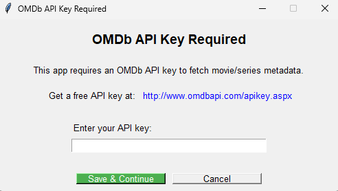
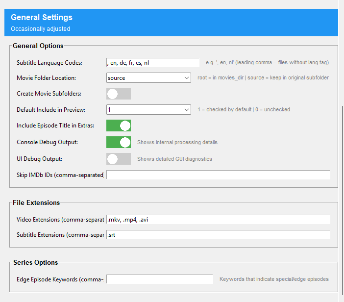
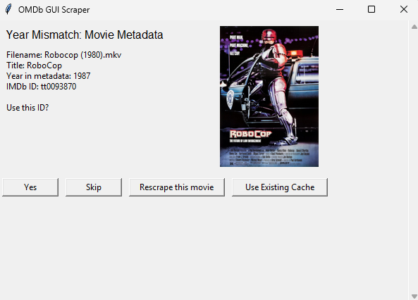
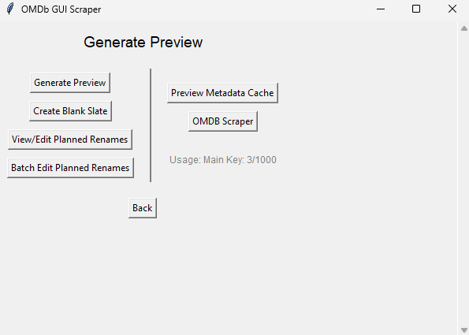
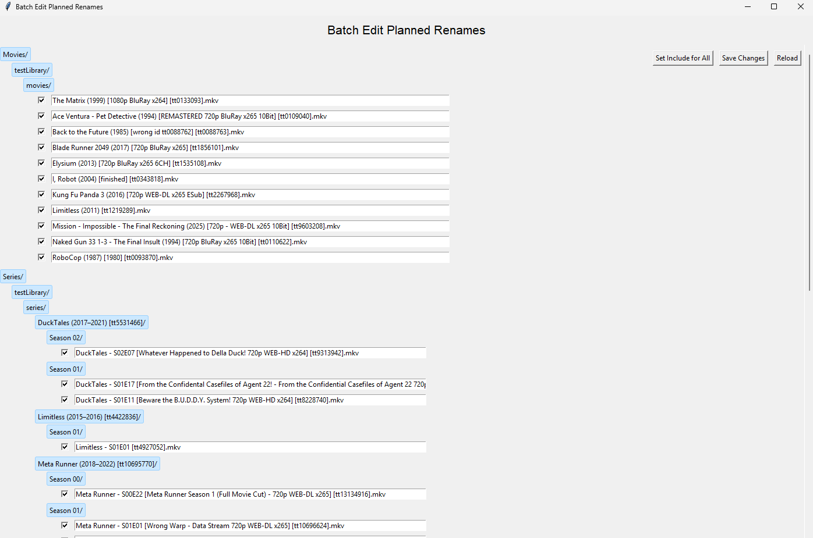
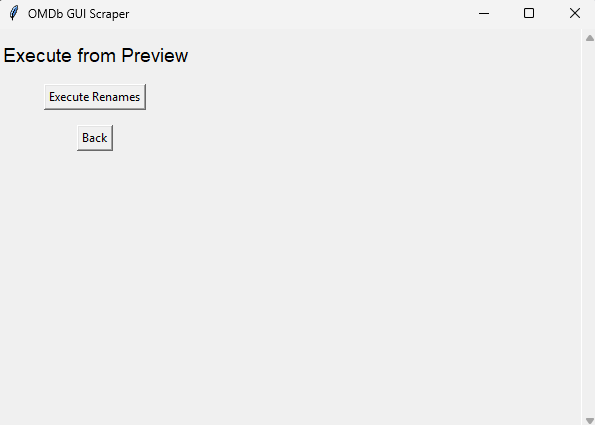

# Media Renamer (Actuall App)

## Short summary
Media Renamer is a lightweight Python + Tkinter app that scans a movie/series library, fetches metadata (OMDb + IMDb HTML scraping), cleans and standardizes titles, builds consistent filenames, and lets you preview and apply renames with manual confirmation when needed.

## Quick start
Requires Python 3.13+ in a virtual environment for consistency.

**Create the virtual environment:**
```powershell
py -m venv .venv
```

**Activate the virtual environment:**
```powershell
.venv\Scripts\Activate.ps1
```

**Install dependencies:**
```powershell
pip install -r requirements.txt
```

**Normal launch:**
```powershell
py .\main.py
```

**Test mode:**
```powershell
py .\main.py test
```

Test mode uses a different config file (`testconfig.ini`) and the test library. It also runs `test_planned_renames.py` to verify renames comply with expectations.


## First Launch
On first launch, you'll be prompted to enter an OMDb API key. The app requires this to fetch movie and series metadata.

**To get a free API key:**
1. Visit [http://www.omdbapi.com/apikey.aspx](http://www.omdbapi.com/apikey.aspx)
2. Sign up for a free API key (1,000 requests/day limit)
3. Enter the key in the prompt when launching the app

The API key will be saved to your config file and you won't need to enter it again.



## The Main Menu


## Configuration
The app provides a user-friendly configuration editor accessible from the main menu. Instead of manually editing `config.ini`, you can use the GUI to adjust settings.

**Features:**
- Form-based interface with toggles, dropdowns, and path browsers
- Organized into Essential Settings and General Settings
- Shows before/after confirmation dialog when saving changes
- Preserves comments and formatting in the config file

**What you can configure:**
- **Media library paths** — movies and series directories
- **OMDb API key** — your API key for metadata fetching
- **Series aliases** — map non-standard folder names to canonical series names
- **Language codes** — subtitle language tags (leading comma = files without language tag)
- **Movie folder location** — create in root or keep in source subfolder
- **Movie subfolders** — whether to create individual folders per movie
- **Default include** — whether new preview entries are checked by default
- **Episode title in extras** — include episode names in extra file tags
- **Debug modes** — console and UI debug output toggles
- **File extensions** — recognized video and subtitle formats
- **Edge keywords** — special episode detection keywords




## What the app does
- Scans movie files and series folders, parsing titles, years, IMDb IDs, and extras.
- Fetches missing metadata and posters using OMDb first, then IMDb HTML scraping if needed.
- Builds consistent destination filenames and folder paths.
- Cleans extras for both movies and series (resolution, audio, tags) and sanitizes paths to avoid path issues.
- Provides an interactive picker for ambiguous matches.
- Writes a preview plan and lets you apply or undo renames.

## Main components (where things live)
- **main.py** — app entry point and test harness.
- **gui/** — Tkinter screens (picker, preview, prompts).
- **actions/** — high-level behaviors (movies, series, preview, OMDb/IMDb scraping).
- **core/** — file parsing, metadata helpers, filename building, cache tools.
- **cache/** — JSON caches (metadata, posters, etc.).
<!-- - **run-tests.py** — deterministic tests using a local OMDb stub. -->

## Key files
- **planned_renames.json** — preview output of source → destination changes.
- **rename_log.txt** — history of applied renames (used for undo).
- **config.ini / config.py** — runtime settings (paths, OMDb host, naming rules).
- **cache/media_metadata.json** — central metadata cache (title/year/imdb/episodes/poster). This is the source of truth.
- **cache/imdb_cache.json** — filename to matched IMDb ID cache. If encountering issues, clear problem entries here.
- **cache/omdb_request_tracking.json** — tracks OMDb API usage per day (rolling 2-day window). Contains user-editable fields: `key_label` (display name), `user_note` (reminder of API limits), and `daily_limit` (requests per day).

## How it works (end-to-end flow)
### 1) Scan
The app walks your folders, identifies movie files and series folders, and parses filenames to extract:
- title
- year
- extras (resolution/audio/tags)
- IMDb ID (if present)

If an IMDb ID is present but missing from the cache, the app fetches metadata automatically:
1) OMDb API
2) IMDb HTML scraping fallback

All network calls run in background threads and show a short wait overlay in the UI.

**Note:** The app treats `cache/media_metadata.json` as the source of truth for all metadata. 

If you encounter incorrect metadata:
1. Check the IMDb ID entry in `cache/media_metadata.json`
2. Open the **Preview Metadata Cache** from the preview window
3. Select the problematic entry
4. Click **Refresh from OMDb** to fetch fresh data

### 2) Match metadata (picker)
If multiple matches are possible, a picker dialog appears. You can confirm, skip, or cancel. The picker distinguishes between movie and series matches so you can make an informed choice.


If a cached entry is found but the year doesn't match, a year mismatch prompt appears:



You can also pick from existing cached entries:


### 3) Build destination names
The app builds a new filename using the cleaned title + year and a normalized extras list. It also sanitizes paths to prevent accidental subfolders.

Anything not in the new filename (but deemed important) is added to extras as a safeguard.

### 4) Preview
The app writes `planned_renames.json` and shows a preview window with all proposed changes. You can edit, enable/disable individual entries, or proceed to execution.

The preview count reflects only actual changes (files already correctly named are filtered out).

The preview window is organized into two columns:
- **Left:** Generate Preview, Create Blank Slate, View/Edit Planned Renames, Batch Edit
- **Right:** Preview Metadata Cache, OMDB Scraper (with usage stats shown at the bottom)

After generating a preview, the console displays:
- Session OMDb request count
- Today's usage: `{key_label}: {today}/{limit} requests (Yesterday: {yesterday})`




Batch edit functionality is available for bulk changes:



Folders can be collapsed to reduce clutter while reviewing entries:


### 5) Execute
When you apply the preview, files are moved/renamed and logged to `rename_log.txt`. Subtitles are moved alongside video files when possible.



### 6) Undo
The undo feature reads `rename_log.txt` and attempts to reverse operations.

⚠️ **IMPORTANT WARNING:** Undo will reverse **EVERY entry** it can find in `rename_log.txt`. It is not limited to the most recent batch. Review the log first if you want selective undo behavior.

<!-- ## Tests (deterministic)
Run tests with the local OMDb stub for stable, reproducible results:

```powershell
py .\run-tests.py
``` -->

## OMDb API request tracking
The app tracks OMDb API usage to help you stay within daily limits (free tier: 1000 requests/day).

**Features:**
- Tracks requests per day with a rolling 2-day window
- Warns at 90% of daily limit
- Displays usage stats in the preview window and after generating previews

**User-editable fields** in `cache/omdb_request_tracking.json`:
- `key_label` — display name for the API key (e.g., "main key", "test key")
- `user_note` — reminder about your API tier/limits
- `daily_limit` — requests allowed per day (default: 1000)

These fields are automatically added when missing and are never overwritten by the app.

## Troubleshooting
- If OMDb or poster scraping hangs, point OMDB_BASE_URL to a local stub or check connectivity.
- If the picker re-prompts unexpectedly, ensure picker state uses boolean flags (selection/skipped/cancelled) and not bound methods.
- If approaching OMDb API limits, check `cache/omdb_request_tracking.json` for today's usage. Consider using test mode with a separate API key or local stub.

## Developer notes
- Network calls must not run on the Tkinter main thread. Use safe_request.
- Avoid import cycles by using local imports when needed.
- Keep edits small and run the test harness after changes that touch caches, parsing, or UI threading.


