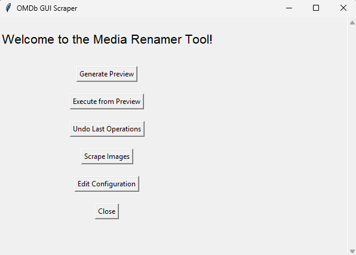
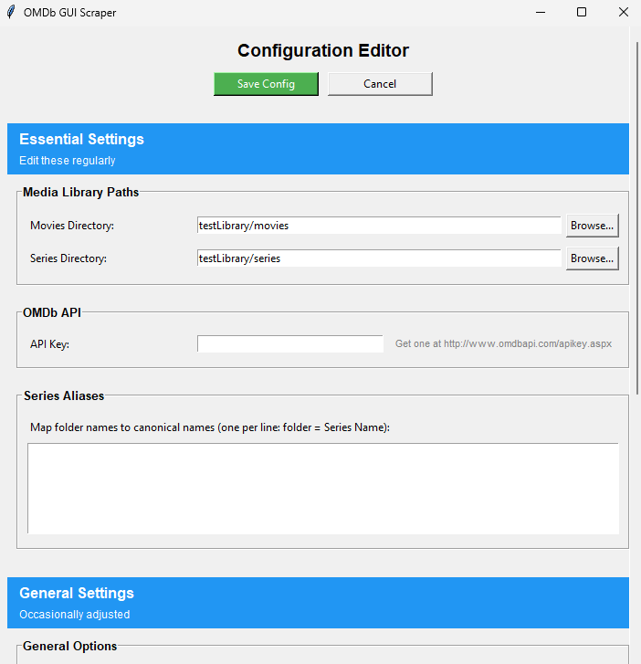
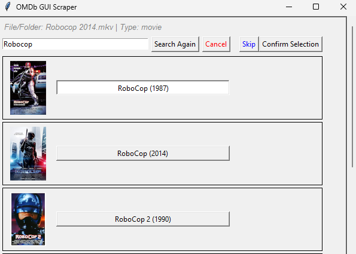
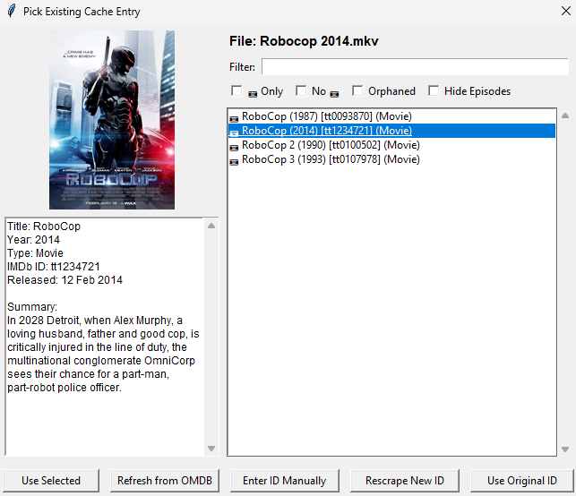
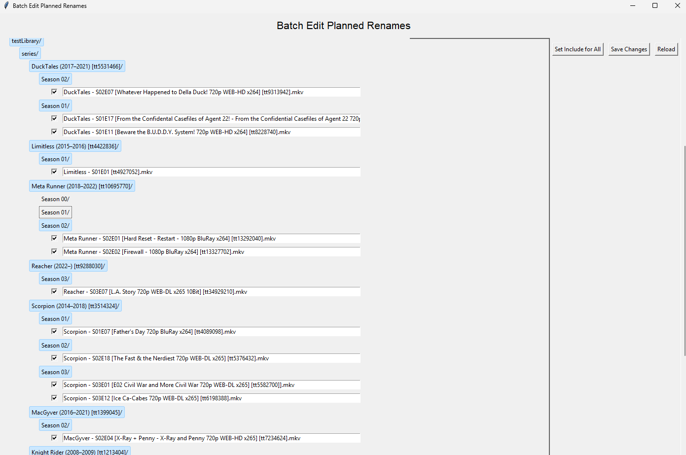

# Rename-o-Matic

**A Python/Tkinter app for organizing and renaming movie and TV libraries.**

Rename-o-Matic scans your media folders, resolves movie and episode metadata, creates consistent names, and gives you a preview before anything is moved or renamed. It uses a Tkinter interface and JSON caches so decisions can be reviewed and reused.

## What it does

- Parses movie and series filenames, including years, IMDb IDs, seasons, episodes, resolutions, audio tags, and subtitles.
- Uses OMDb metadata and IMDb HTML scraping as metadata sources.
- Detects ambiguous matches and asks for confirmation through interactive dialogs.
- Builds clean, predictable movie files/folders and episode filenames.
- Supports season/episode remapping, manual series mode, and batch editing.
- Writes rename plans for review before execution.
- Records applied operations in `rename_log.txt`; undo reverses every entry the log can currently reverse.
- Keeps metadata, episode, poster, and OMDb usage caches in `cache/`.

## Requirements

- Python 3.13
- An OMDb API key
- Tkinter support from your Python installation

## Install

Create a local virtual environment from the repository root. The `.venv` directory is not included in the repository.

**Windows**

```powershell
py -3.13 -m venv .venv
.venv\Scripts\python.exe -m pip install --upgrade pip
.venv\Scripts\python.exe -m pip install -r requirements.txt
```

**macOS or Linux**

```sh
python3 -m venv .venv
.venv/bin/python -m pip install --upgrade pip
.venv/bin/python -m pip install -r requirements.txt
```

Tkinter must be available in your Python installation. It is included with most standard Python distributions, while some Linux distributions require a package such as `python3-tk`.

## Run

**Windows**

```powershell
.venv\Scripts\python.exe .\main.py
```

**macOS or Linux**

```sh
.venv/bin/python ./main.py
```


## Test mode

**Windows**

```powershell
.venv\Scripts\python.exe .\main.py test
```

**macOS or Linux**

```sh
.venv/bin/python ./main.py test
```

Test mode uses `testconfig.ini` and `testLibrary/` instead of the normal configuration and media paths. The preview flow can also run `test_planned_renames.py` for test-mode validation.

## First launch


On first launch, Rename-o-Matic opens an API-key prompt if `OMDb > omdb_api_key` is empty or still set to `key`. Request a key from [OMDb](https://www.omdbapi.com/apikey.aspx), enter it in the prompt, and restart the app.

**Do not share the API key.**


After configuration, the main menu provides preview generation, execution, undo, image scraping, and configuration editing.



## Configuration

Open **Edit Configuration** in the app to change settings through the GUI. Saving shows a before/after confirmation and preserves the config file.

The main settings are in `config.ini`:

- `Paths`: movie and series library directories
- `OMDb`: API key and endpoint settings
- `SeriesAliases`: maps folder names to canonical series names
- `General`: subtitle language tags, movie folder layout, preview defaults, debug flags, and skipped IMDb IDs
- `Extensions`: recognized video and subtitle extensions
- `Series`: edge-case keywords
- `OMDbAdvanced`: request delay, search limit, and HTTP user agents
- `InternalPaths`: cache and rename-log filenames




## Rename workflow

### 1. Scan

Rename-o-Matic walks the configured movie and series directories and extracts available metadata. It identifies:

- Titles and years
- IMDb IDs
- Season and episode numbers
- Resolution, audio, subtitle, and other extra tags

When metadata is missing or ambiguous, the app uses the OMDb and IMDb tools and may show a picker or mismatch prompt.

Network requests run in background threads so the Tkinter interface stays responsive.

### 2. Resolve metadata

Interactive dialogs handle uncertain title matches, IMDb ID conflicts, years, cache entries, episodes, and season numbering.






### 3. Review

The preview stores proposed source/destination pairs in `planned_renames.json`. Only real changes are shown; files that already match the generated name are filtered out.

From the preview, you can generate a plan, start with a blank plan, edit planned names, batch-edit entries, inspect or refresh metadata, open the OMDb scraper, or remap seasons and episodes.




### 4. Apply

Execution moves or renames selected entries and moves matching subtitles with their video files where possible. Each operation is recorded in `rename_log.txt`.


### 5. Undo

The undo window reads `rename_log.txt` and reverses the operations recorded there.

**Warning:** undo is not guaranteed to be limited to the most recent preview. Review the log before undoing changes, especially after several rename sessions.

## Cache and state files

- `config.ini` - normal runtime configuration
- `testconfig.ini` - test-mode configuration
- `planned_renames.json` - current preview plan
- `rename_log.txt` - rename history used by undo
- `cache/media_metadata.json` - central movie, series, episode, and poster metadata cache
- `cache/imdb_cache.json` - filename/series names mapped to IMDb IDs
- `cache/manual_episode_cache.json` - manually selected episode IMDb IDs
- `cache/manual_episode_title_cache.json` - manually selected episode titles
- `cache/omdb_request_tracking.json` - local OMDb usage tracking
- `cache/poster_url_cache.json` - poster URL cache

OMDb usage tracking records the current day, the previous day, a display label, an optional note, and a configurable daily request limit. Remove or refresh cache entries when stale or incorrect metadata needs to be replaced.

## Local IMDb API tool

The `tools/imdb_local_api/` directory contains a FastAPI/uvicorn helper for serving IMDb data from a local dataset. It is optional and not required for the desktop app's normal flow.

If that tool is used, its required packages are included in `requirements.txt`.

## Project layout

- `main.py` - application entry point and test-mode setup
- `gui/` - Tkinter windows, menus, pickers, preview, configuration, and prompts
- `actions/` - movie, series, preview, scraping, and remapping operations
- `core/` - filename parsing, metadata cache, file utilities, and naming helpers
- `cache/` - generated metadata and request-state JSON files
- `tools/imdb_local_api/` - optional local FastAPI IMDb service

## Known limitations

Media filenames can contain an almost unlimited combination of release groups, quality tags, codecs, language markers, subtitles, collections, punctuation, and unofficial episode names. Some unusual naming patterns may not be recognized or may require manual correction. If a filename is missed or misinterpreted, use the preview, cache, and manual matching tools before applying changes.

## Troubleshooting

- **The app closes before opening:** make sure the `OMDb` key is valid and installed dependencies are in `.venv`.
- **A metadata request hangs:** check connectivity or temporarily point `omdb_base_url` to a local test service.
- **The wrong match is selected:** clear or refresh the relevant entry in `cache/media_metadata.json` or `cache/imdb_cache.json`, then regenerate the preview.
- **OMDb usage is blocked:** inspect `cache/omdb_request_tracking.json` and your OMDb account limits.
- **A preview behaves unexpectedly in test mode:** verify `testconfig.ini` and the paths under `testLibrary/`.
